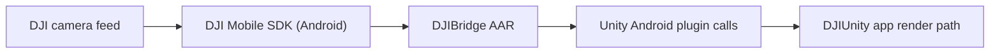

# DJIBridge

Android bridge library built as a single AAR for the Unity app. It now contains both the Kotlin DJI SDK integration and the native `djiunity` render plugin used by Unity for OES texture updates.

The usual workflow is:

- build `DJIBridge` as an AAR
- copy the AAR into `DJIUnity/Assets/Plugins/Android/`
- rebuild the Unity Android app

---

## Role In The System



`DJIBridge` is responsible for:

- initializing and registering the DJI Mobile SDK
- connecting the decoded video pipeline to a `Surface`
- exposing Unity-facing entry points through static Android/Kotlin APIs
- packaging the `djiunity` native library that Unity loads via `DllImport`

---

## Requirements

- Android Studio / Gradle
- Android SDK
- DJI developer account
- DJI Mobile SDK dependencies available to Gradle

---

## DJI API Key Setup

The AAR does not require or contain a DJI API key. Its Android manifest
retains the `DJI_API_KEY` placeholder, resolved by the consuming Android
application. For Unity, set `DJI_API_KEY` in the environment before starting
the Editor, or in the local Gradle user properties. Never commit the key.

Copy `local.properties.example` to the ignored `local.properties` if you need
to specify the SDK path for the bridge build.

If the key was ever committed previously, treat it as exposed and rotate it in the DJI developer portal.

---

## Build

Windows:

```bat
gradlew.bat assembleRelease
```

macOS/Linux:

```bash
./gradlew assembleRelease
```

Output:

```text
build/outputs/aar/DJIUnityBridge.aar
```

---

## Unity Integration

Copy the built AAR here:

```text
DJIUnity/Assets/Plugins/Android/DJIUnityBridge.aar
```

This single AAR already contains the native `djiunity` library, so the old standalone `DJIUnityNative-release.aar` should not be kept in the Unity plugin folder.

---

## Registration Notes

The DJI SDK registration only succeeds if all of these match:

- the `DJI_API_KEY`
- the Android package name of the built Unity app
- the signing certificate used to sign the APK/AAB

Current Unity package name in this workspace:

```text
com.sok9hu
```

If the DJI developer portal is configured for a different package name or certificate, registration will fail and no video feed will appear.

---

## Troubleshooting

### `onRegisterFailure: The metadata received from server is invalid`

This usually means a DJI registration mismatch, not a rendering bug.

Check:

- the API key value
- the Unity Android package name
- the signing certificate configured on the DJI side

### Missing native plugin symbols in Unity

If Unity reports it cannot find `djiunity` native functions:

- rebuild `DJIBridge`
- recopy `DJIUnityBridge.aar` into `Assets/Plugins/Android`
- make sure the old `DJIUnityNative-release.aar` is no longer present alongside it

### No video, black screen

If the Unity side renders the external texture but no frames arrive:

- confirm DJI SDK registration succeeded
- confirm product connection succeeded
- confirm the RC/phone USB accessory is visible and permission is granted

---

## Related Projects

- `DJIUnity`: main Unity Android application
- `DJIUnityNative`: deprecated standalone repo kept only for history; the native code now lives in `DJIBridge`
