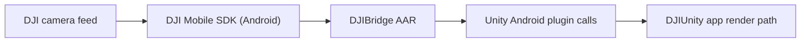

# DJIBridge

Android bridge library built as a single AAR for the Unity app. It now contains both the Kotlin DJI SDK integration and the native `djiunity` render plugin used by Unity for OES texture updates.

The usual workflow is:

- build `DJIBridge` as an AAR
- copy the AAR into `DJIUnity/Assets/Plugins/Android/`
- rebuild the Unity Android app

---

## Role In The System



`DJIBridge` is responsible for:

- initializing and registering the DJI Mobile SDK
- connecting the decoded video pipeline to a `Surface`
- exposing Unity-facing entry points through static Android/Kotlin APIs
- packaging the `djiunity` native library that Unity loads via `DllImport`

---

## Requirements

- Android Studio / Gradle
- Android SDK
- DJI developer account
- DJI Mobile SDK dependencies available to Gradle

---

## DJI API Key Setup

The AAR does not require or contain a DJI API key. Its Android manifest
retains the `DJI_API_KEY` placeholder, resolved by the consuming Android
application. For Unity, set `DJI_API_KEY` in the environment before starting
the Editor, or in the local Gradle user properties. Never commit the key.

Copy `local.properties.example` to the ignored `local.properties` if you need
to specify the SDK path for the bridge build.

If the key was ever committed previously, treat it as exposed and rotate it in the DJI developer portal.

---

## Build

Windows:

```bat
gradlew.bat assembleRelease
```

macOS/Linux:

```bash
./gradlew assembleRelease
```

Output:

```text
build/outputs/aar/DJIUnityBridge.aar
```

### Final Release Validation

Four-tag multistart is mandatory for the Android bridge. Gradle, CMake, and
the native source default to ON and reject shipping builds with it disabled.
The existing property `DJI_APRILTAG_FOUR_TAG_MULTISTART_EXPERIMENT` may be
omitted or explicitly set to `true`; setting it to `false` fails configuration.
The release filename is always `DJIUnityBridge.aar`.

For a fresh release and fresh JVM reports, without reusing build-cache results:

```bat
gradlew.bat rebuildRelease testReleaseUnitTest --rerun-tasks --no-build-cache
```

`rebuildRelease` builds the AAR and verifies its feature provenance. The
`bundleReleaseAar` task also finalizes with `verifyReleaseBridgeFeatures`.
The latter validates the final ZIP contents, all four native SHA-256 hashes,
ELF architecture, and each ABI's exported JNI getter returning true.

### AAR Feature Provenance Contract

The release AAR contains `assets/roofcanopy-bridge-features.json`:

```json
{
  "schemaVersion": 1,
  "fourTagMultiStart": true,
  "nativeLibraries": [
    { "abi": "arm64-v8a", "sha256": "<64 lowercase hexadecimal characters>" },
    { "abi": "armeabi-v7a", "sha256": "<64 lowercase hexadecimal characters>" },
    { "abi": "x86", "sha256": "<64 lowercase hexadecimal characters>" },
    { "abi": "x86_64", "sha256": "<64 lowercase hexadecimal characters>" }
  ]
}
```

Each digest identifies the full bytes of `jni/<abi>/libdjiunity.so` in that
AAR, not a source file or an arbitrary CMake cache output. The generated assets
task depends on `mergeReleaseNativeLibs` and consumes its declared outputs;
the assets merger depends on that generator. Generation fails unless all four
ELF binaries independently prove multistart ON. Final AAR verification detects
packaging changes, stale metadata, missing ABIs, and duplicate ZIP entries.
The existing `!*` Android asset exclusion remains intact. The AAR ZIP task
explicitly includes only this generated JSON so unrelated assets stay excluded.

The compile-time getter is the existing exported symbol:

```text
Java_com_sok9hu_djibridge_DjiBoardVisionNative_isFourTagMultiStartExperimentEnabled
```

It returns the actual C++ macro, not a Kotlin/Gradle constant. For ARM64 release
the symbol's eight bytes are `20 00 80 52 c0 03 5f d6` (`mov w0, #1; ret`).
Consumers should resolve it through ELF `.dynsym` and check its code, in
addition to checking the schema, exact ABI set, and hashes. Metadata alone is
not proof of the compiled feature and is not an authenticity signature.
The bytecode check intentionally fails closed if compiler output changes.

### Standalone Host Replay

`src/testNative/board_pose_multistart_test.cpp` explicitly enables
`DJI_BOARD_POSE_REPLAY_TEST=1` and can be compiled twice with
`DJI_APRILTAG_FOUR_TAG_MULTISTART_EXPERIMENT=0` and `=1` for legacy/ON parity.
This exemption is standalone-only: the shipping CMake project rejects OFF
and replay mode. A standalone Android native fixture executable can use the
explicit replay macro for OFF/ON validation without building or installing an APK.

The executable accepts `fixture_path output_prefix [benchmark_repeats]` and
writes fresh case XML, result CSV, diagnostics JSONL, benchmark CSV, and a
summary JSON. The existing 132-fixture suite has 1,858 checks per mode. Windows
host execution requires a complete C++ toolchain including Windows SDK/UCRT,
not merely `cl.exe`. Do not install an APK or use a phone as a silent fallback;
standalone native device validation requires explicit authorization.

---

## Unity Integration

Copy the built AAR here:

```text
DJIUnity/Assets/Plugins/Android/DJIUnityBridge.aar
```

This single AAR already contains the native `djiunity` library, so the old standalone `DJIUnityNative-release.aar` should not be kept in the Unity plugin folder.

---

## Registration Notes

The DJI SDK registration only succeeds if all of these match:

- the `DJI_API_KEY`
- the Android package name of the built Unity app
- the signing certificate used to sign the APK/AAB

Current Unity package name in this workspace:

```text
com.sok9hu
```

If the DJI developer portal is configured for a different package name or certificate, registration will fail and no video feed will appear.

---

## Troubleshooting

### `onRegisterFailure: The metadata received from server is invalid`

This usually means a DJI registration mismatch, not a rendering bug.

Check:

- the API key value
- the Unity Android package name
- the signing certificate configured on the DJI side

### Missing native plugin symbols in Unity

If Unity reports it cannot find `djiunity` native functions:

- rebuild `DJIBridge`
- recopy `DJIUnityBridge.aar` into `Assets/Plugins/Android`
- make sure the old `DJIUnityNative-release.aar` is no longer present alongside it

### No video, black screen

If the Unity side renders the external texture but no frames arrive:

- confirm DJI SDK registration succeeded
- confirm product connection succeeded
- confirm the RC/phone USB accessory is visible and permission is granted

---

## Related Projects

- `DJIUnity`: main Unity Android application
- `DJIUnityNative`: deprecated standalone repo kept only for history; the native code now lives in `DJIBridge`
